  
  
  

---

## 🧑‍💻 About me

> Bachelor in **Applied Computer Science** at Erasmushogeschool Brussel (2024 – present), previously trained in **Industrial ICT** at Technov (Vilvoorde).

- 🔍 Looking for an **internship** to gain hands-on experience and contribute to a team
- 🤖 Interested in **LLM API integration**, **AI agent development** and **AI-driven development**
- 🦾 Hands-on with **robotics**: ROS2, MQTT, sensor data (IMU, odometry) and live dashboards
- 🤝 Motivated, reliable and curious: I enjoy teamwork and pick up new things fast
- 🌍 Languages: 🇫🇷 French (native) · 🇳🇱 Dutch (native) · 🇬🇧 English (very good) · 🇲🇦 Arabic (good)

---

## 🛠️ Tech stack

 

| | |
|---|---|
| 💻 **Development** | Python · Java · C++ · C# / .NET · PHP / Laravel · TypeScript / React · Node.js · SQL |
| 🤖 **Robotics** | ROS2 · MQTT · IMU & odometry · real-time dashboards |
| 🧠 **AI** | LLM API integration · AI agent development · AI-driven development |
| ⚙️ **DevOps & data** | Docker · RabbitMQ · Firebase · SQLite / MySQL · Git & GitHub |

---

## 🚀 Projects

<table>
<tr>
<td width="50%" valign="top">

### 🕌 SmartMadrasa 🔒
School management system for Islamic schools: multilingual (FR / NL / AR), secure and GDPR-focused.
 `React` `TypeScript` `Vite` `Firebase`
 Private repository

</td>
<td width="50%" valign="top">

### 🌐 [SmartMadrassa website](https://github.com/Yas3tech/smartmadrassa-site)
Premium showcase site with scroll choreography (GSAP ScrollTrigger), Framer Motion components, a WebGL shader and light/dark themes, live at [smartmadrassa.be](https://smartmadrassa.be).
 `React` `TypeScript` `Tailwind` `GSAP`

</td>
</tr>
<tr>
<td valign="top">

### 🤖 [RoboTrack Monitor](https://github.com/Yas3tech/IntelligentRobotics-Project)
Real-time web dashboard monitoring autonomous robots on a course, with an MQTT bridge to ROS2 (EHB Intelligent Robotics).
 `Python` `MQTT` `ROS2` `Node.js`

</td>
<td valign="top">

### 🐆 [Jaguar Project](https://github.com/Yas3tech/Jaguar-Project)
Driving a Dr Robot Jaguar 4x4: slip-aware odometry, IMU, route driving and a ride analysis dashboard.
 `Python` `HTML` `IMU`

</td>
</tr>
<tr>
<td valign="top">

### 🎪 [ShiftFestival frontend](https://github.com/IntegrationProject-Groep1/IP-groep1-frontend)
Drupal 10 event platform with RabbitMQ integration, session management and company registration. *Team project.*
 `PHP` `Drupal` `RabbitMQ` `Docker`

</td>
<td valign="top">

### 📅 [Planning Service](https://github.com/IntegrationProject-Groep1/Planning)
Consumes session messages from RabbitMQ and syncs Outlook calendar appointments through Microsoft Graph. *Team project.*
 `Python` `RabbitMQ` `Docker`

</td>
</tr>
<tr>
<td valign="top">

### 🤝 Skillsy 🔒
Mobile app where neighbours share and swap skills. Auth and profile creation, an explore map with GDPR-friendly fuzzy locations, a video feed with comments, chat, match requests, appointments with overlap checks, reviews and toast notifications. I also built the **AI skill-matching pipeline**: free text such as "gitaar" is scored against known skills (semantic embeddings, fuzzy matching and popularity), mapped automatically, nudged to a suggestion, or routed to a new category, with a Wikipedia fallback for unknown terms and a local LLM service behind it. *Team project (6 contributors).*
 `React Native` `Expo` `TypeScript` `Firebase` `Local LLM`
 Private repository

</td>
<td valign="top">

### 🎵 DarijaVerse AI
Upload a video or audio clip (or paste a link) and get Arabic lyrics, phonetic transcription, French translation and a synced karaoke player, with SRT / VTT / LRC export.
 `FastAPI` `React` `Python`
 Local project

</td>
</tr>
<tr>
<td valign="top">

### 👓 [Opticalium](https://github.com/Yas3tech/optiek-project)
Web application for an optician: appointments, glasses catalogue, news, FAQ and an admin interface.
 `Laravel 12` `Tailwind`

</td>
<td valign="top">

### 🧾 Optician ERP (Odoo)
Custom Odoo modules for an optician: sales, stock, prescriptions, agenda, accounting, after-sales and GDPR.
 `Odoo` `Python` `Docker`
 Local project

</td>
</tr>
<tr>
<td valign="top">

### 🕋 Mosque website
Official site of a mosque in Diegem in FR / NL / AR: live prayer times from Mawaqit, 3D scenes with React Three Fiber, Motion animations, donations and an admin area.
 `Next.js 16` `React Three Fiber` `Three.js` `Motion` `Tailwind 4` `Drizzle`
 Local project

</td>
<td valign="top">

### 🗂️ [Events & Organisers API](https://github.com/Yas3tech/node-project)
REST API with a built-in playground and documentation.
 `Node.js` `Express` `SQLite`

</td>
</tr>
<tr>
<td valign="top">

### 🌍 [Countries explorer](https://github.com/Yas3tech/projectWEB)
SPA to search, filter, sort and favourite countries via the REST Countries API.
 `JavaScript`

</td>
<td valign="top">

### 🗣️ Moutarjim 🔒
Web application built with Flask.
 `Python` `Flask`
 Private repository

</td>
</tr>
<tr>
<td valign="top">

### 🫀 IMPACT website
Website for the IMPACT student organisation: workshops, programme, member accounts and registrations, an admin panel and an interactive home page with 3D particle organs (a heart and other organs generated from signed distance fields, rendered in Three.js), animated ECG traces and scroll motion. Hosted on OVH.
 `Three.js` `WebGL` `JavaScript` `PHP` `Node build`
 Local project

</td>
<td valign="top">

### ♟️ Chess analysis tool
Chess analysis web app powered by the Stockfish engine.
 `JavaScript` `Stockfish`
 Local project

</td>
</tr>
<tr>
<td valign="top">

### 🌐 Live Translate
Live translation pipeline: a local LLM (Ollama) and the NLLB-600M model (CTranslate2) behind a Flask + Socket.IO server, pushing results to a live viewer page published through a Cloudflare tunnel.
 `Python` `Ollama` `NLLB` `Socket.IO`
 Local project

</td>
<td valign="top">

### 💬 Youth Q&A platform
PHP web platform where young people submit questions and moderators validate, order and answer them. Three roles (admin, speaker, supervisor), user management, password reset and a feedback inbox.
 `PHP` `MySQL` `JavaScript`
 Local project

</td>
</tr>
<tr>
<td valign="top">

### 🎬 IMPACT Reel Studio
Production of a 9:16 promo reel for IMPACT: storyboard, an AI presenter with lip sync (Higgsfield), B-roll, ECG overlay and a scripted render with Node and ffmpeg.
 `Node.js` `ffmpeg` `Higgsfield` `AI video`
 Local project

</td>
<td valign="top">

### 🧪 AI Video Lab
Local lab for generative video: keyframe generation in ComfyUI, face swap with FaceFusion on the GPU, video models through the Sunra API, and ffmpeg for cutting and testing results.
 `ComfyUI` `FaceFusion` `Sunra API` `ffmpeg`
 Local project

</td>
</tr>
<tr>
<td valign="top">

### 🎞️ AI short-film pipeline
Scripted pipeline that turns generated keyframes, voice, lip sync and sound effects into a 16:9 film: Whisper transcription, bilingual (AR / FR) subtitles, sound mix and colour grade, all rebuilt from one command.
 `Python` `Whisper` `ffmpeg` `AI video`
 Local project

</td>
<td valign="top">

### 🚧 More coming
New experiments land here as they get built.

</td>
</tr>
</table>

---

## 🧠 Local AI & generative models

I like running models **on my own machine**, not only calling APIs:

- **Local LLMs with Ollama:** Qwen 2.5 (7B, 14B), Aya and Aya Expanse (8B), Gemma 7B, used for translation and text tasks
- **ComfyUI:** node-based image and video generation workflows on a local NVIDIA GPU
- **FaceFusion:** face swap and enhancement on video
- **Whisper and NLLB:** speech transcription and machine translation (CTranslate2) without sending data to the cloud
- **Hosted models when needed:** Sunra and Higgsfield for video generation, combined with local tools

---

## 🐍 Activity

<picture>
  <source media="(prefers-color-scheme: dark)" srcset="https://raw.githubusercontent.com/Yas3tech/Yas3tech/output/snake-dark.svg" />
  
</picture>

---

## 🎯 Beyond code

⚽ Football · 💡 Tech innovation · 📚 Always learning · ✈️ Travelling

### 📫 Have an internship to offer? Let's talk!

[LinkedIn](https://www.linkedin.com/in/yassine-eddouks-167288294/) · [Email](mailto:eddouksy@gmail.com)

